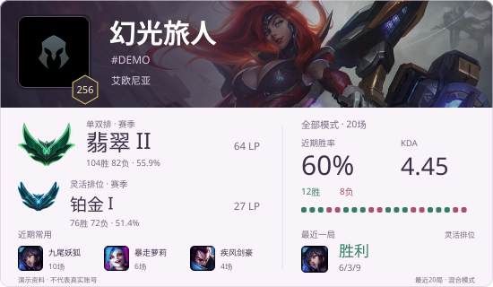

# League Card

紧凑的英雄联盟个人SVG资料卡。头像、英雄横幅、赛季段位和近期战绩，放进可独立嵌入主页的图片。

**当前为预览版：渲染、快照服务、本机只读采集备选和双端发布已实现；国服免客户端远程来源尚未接通，不能仅凭ID持续自动更新。** 默认服务只读快照，不启动或连接游戏客户端。





以上为独立构造的演示资料，不对应真实账号。

## 外观

- 标准550×320、Mini400×120，两套独立布局。
- 武装战姬厄运小姐、阿狸、亚索、金克丝横幅；深色和浅色主题。
- 真实头像、游戏段位徽章、常用英雄、等级六边形和真实对局胜负轨迹。
- 不展示无意义的进度横条、阈值能力雷达或重复统计徽章。
- 轻动效、24帧环境光效、静态；遵从减少动画偏好。24帧为SVG光效，不是角色原画帧动画。
- 图片与字体内嵌、重复图片去重；无前端框架，无第三方运行依赖。



## 本机运行

需要Node.js 22+和package.json声明的pnpm版本。

```powershell
git clone https://github.com/szoxidy/lol-stats-card.git
Set-Location lol-stats-card
pnpm install --frozen-lockfile
Copy-Item config/player.example.json config/player.json
pnpm dev
```

打开`http://127.0.0.1:4187/`。编辑`config/player.json`配置昵称、标签和大区，该文件不会提交。没有真实快照时显示待更新，不用演示战绩顶替。“刷新预览”只重新读取快照，不查询账号。

```text
/card.svg?layout=wide&theme=dark&background=miss-fortune&motion=subtle&queue=hextech
```

| 参数 | 可选值 |
| --- | --- |
| `layout` | `wide`、`compact` |
| `theme` | `dark`、`light` |
| `background` | `miss-fortune`、`ahri`、`yasuo`、`jinx` |
| `motion` | `subtle`、`frames`、`static` |
| `queue` | `all`、`solo`、`flex`、`ranked`、`hextech`、`aram`、`normal` |
| `download` | 存在时返回下载文件 |

可用博客``或Markdown图片嵌入。GitHub等平台的图片代理可能缓存结果或停止动画。

## 数据口径

渲染读取`data/profile.json`。`GET /api/profile`不公开内部账号哈希或客户端凭据。

- KDA为`(总击杀+总助攻)/max(1,总死亡)`。
- 近期胜率只针对已识别的本人对局，不是总胜率或赛季胜率。
- 区分峡谷、极地及`KIWI / queueId 2400`海克斯大乱斗；排除重复、早期重开和无法识别的本人记录。
- 模式参数同时筛选近期胜率、KDA、常用英雄、胜负轨迹和最近一局。赛季排位胜负与近期统计独立。
- 当前快照只保留所有模式合计的最近20局；选择模式是在这20局中筛选，不会伪称取得该模式的最近20局。例如其中仅5场灵活排位，就显示5场。没有匹配对局时明确显示空状态。
- 缺失、空历史、未定级和来源失败分别处理；部分失败保留已有资料并标记时间。
- 头像编号、图片和来源一并保存；换编号取图失败时不沿用旧头像。`reference-match`只表示按参考匹配官方素材，不能视作已核验的账号关联。

## 可选本机采集

```powershell
pnpm probe:client
pnpm sync:client
```

显式备选，需要本人已登录客户端，与免客户端更新不同。只读本人资料、段位、近期战绩和图标；不执行游戏操作、不注入、不读进程内存。认证信息仅在进程内存中使用，持久化采用字段白名单。

对局中大厅界面关闭时会继续识别后台客户端；后台未暴露可读会话时返回连接信息不可用，不能把发现进程当成已经读取到账号数据。旗帜、挑战勋章及账号背景需要实际资料验证后接入，不在示例中编造。

服务默认禁用本机同步入口；公网展示服务保持`LOL_CARD_ENABLE_LOCAL_SYNC`关闭。

## 国内和国外独立展示

`src/publish.mjs`并发发布同一白名单快照，各端独立保存、渲染；一端失败不阻断另一端，也不清除上次成功数据。展示不跨境回源。

- `PUT /api/snapshot`：Bearer认证写入，拒绝错误账号与更旧快照。
- `GET /card.svg`：支持ETag/304和短期缓存。
- `GET /health`：检查服务及数据状态。
- 模板位于`deploy/`，目标配置复制自`config/targets.example.json`；凭据通过环境变量提供。

`LOL_CARD_SYNC_TOKEN`至少32字符。真实源站、TLS、DNS分线路和双端图片均需分别验收。模板不代表已经部署，也不提供可用的国服远程数据源。

## 开发

```powershell
pnpm check          # 语法检查
pnpm test           # 数据、账号隔离、动画、采集与双端发布回归
pnpm audit:release  # 核对已跟踪文件的私人路径、账号名称与疑似凭据
pnpm examples       # 独立生成文档演示卡，不接触data目录
```

仓库包含压缩素材，首次运行无需联网下载。`pnpm assets`更新英雄目录，`pnpm assets:icons`需FFmpeg。来源与哈希在`assets/`的来源文件中。

设计研究和取舍见[设计记录](docs/design-study.md)。样式用实际页面与窄屏截图检查；测试通过不代替视觉验收。

## 致谢与许可

主要构图参考[osu-stats-signature](https://github.com/solstice23/osu-stats-signature)，并研究了[Steam Card](https://github.com/yuyinws/steam-card)、[EnkaCard](https://github.com/DEViantUA/EnkaCard)、[Streak Stats](https://github.com/DenverCoder1/github-readme-streak-stats)和[yumu-image](https://github.com/yumu-bot/yumu-image)的布局与组件组织，未引入其运行依赖。

原创代码采用[MIT](LICENSE)。游戏美术和商标归Riot Games等权利方所有，字体保留OFL许可，均不因本仓库MIT许可而改变。详细来源与上游通知见[THIRD_PARTY_NOTICES.md](THIRD_PARTY_NOTICES.md)。本项目与Riot Games、腾讯无隶属或背书关系。
